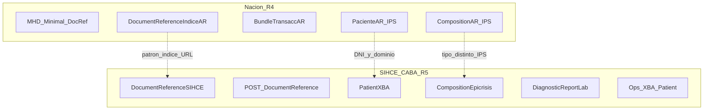

# Análisis: SIHCE CABA vs CONECTATON Nación (MSAL)

**Fecha:** 2026-07-13  
**Propósito:** Documento de trabajo para analizar diferencias y un posible camino de armonización **sin perder** la funcionalidad actual de la guía SIHCE (CABA).  
**Estado:** Solo análisis / plan — **no implementado**.

---

## 1. Material de referencia

| Ítem | Detalle |
|------|---------|
| Paquete Nación | Descargado de `https://conectaton.msal.gob.ar/package.tgz` |
| Ubicación local | `_compare-nacion/package.tgz` (extraer con `tar -xzf package.tgz` en esa carpeta) |
| Paquete | `hl7.fhir.ar.ips` **0.1.0** |
| Canonical Nación | `https://conectaton.msal.gob.ar` |
| FHIR Nación | **4.0.1** |
| Título Nación | CONECTATON Argentina - Interoperabilidad de Historia Clínica |
| Publicación | `notForPublication: true` (draft de conectatón) |
| Dependencias Nación | IPS 1.1.0, IHE MHD 4.2.2, terminology/extensions R4 |
| Guía CABA | `SIHCE.fhir.core` **1.3.0**, canonical `http://sihce.gob.ar`, FHIR **R5**, sin `dependsOn` nacional |

### Perfiles en el paquete Nación

- `PacienteAR` (base Patient-uv-ips)
- `DocumentReferenceIndiceAR` (base IHE.MHD.Minimal.DocumentReference)
- `DocumentReferenceOrigenAR` (base MHD Minimal)
- `CompositionAR` (base Composition-uv-ips)
- `BundleDocAR` (base Bundle-uv-ips)
- `BundleTransaccAR` (base MHD Minimal ProvideBundle)
- `ListAR` (base MHD Minimal SubmissionSet)
- `OrganizationAREstablecimiento`, `PractitionerAR`
- Ejemplos IPS (Composition, Condition, Immunization, MedicationStatement, AllergyIntolerance, DocumentReference PDF IPS LOINC 60591-5)

### Capacidades clave SIHCE CABA (a preservar)

- Operaciones persona vía Canal X-BA: `GET/POST Patient`, `$patch-identifier`, `$update-sdm`
- Índice documental: `POST/GET DocumentReference` (`patient.identifier`, tipo LOINC)
- Epicrisis (18842-5) niveles 1–3 (Binary / Composition / codificado)
- Informe laboratorio (11502-2) con DiagnosticReport + Observation (niveles 1–2)
- NamingSystems CABA (`http://sihce.gob.ar/persona`, RENAPER local, dominios MSGC/HIBA)

---

## 2. Hallazgos (diferencias estructurales)

### 2.1 FHIR R4 vs R5 — el bloqueo principal

Nación es **R4**; SIHCE es **R5**. Eso impide hoy un `dependsOn` limpio del paquete nacional en SUSHI/publisher R5. Además R4 `DocumentReference.masterIdentifier` no existe igual en R5 (se mapea a `identifier`).

**Implicación:** la armonización inmediata debe ser **semántica y documental**, no dependencia de paquete.

### 2.2 Modelo de documentos

| Aspecto | Nación | SIHCE CABA |
|---------|--------|------------|
| Índice | `DocumentReferenceIndiceAR` (MHD Minimal) | `DocumentReferenceSIHCE` |
| Contenido en dominio | DocRef Origen + Provide Bundle | URL en `content.attachment.url` (Binary / Composition / DiagnosticReport) |
| Registro típico | Bundle transaccional MHD (List + DocRef + Bundle doc + Patient) | Solo `POST DocumentReference` (metadatos) |
| Custodian (índice) | Preferido **identifier** (sin `reference`) | `Reference(Organization)` opcional |
| Tipo “estrella” en ejemplos | IPS **60591-5** | Epicrisis **18842-5**, Lab **11502-2** |

**Convergencia natural:** ambos usan DocumentReference de índice + URL al contenido. La arquitectura CABA ya es cercana a *IndiceAR*; falta el “sabor” MHD/Provide y el IPS.

### 2.3 Paciente

| Aspecto | Nación `PacienteAR` | SIHCE `PatientXBA` |
|---------|---------------------|--------------------|
| Base | Patient-uv-ips | Patient R5 |
| Documento | Slice DocumentoUnico 1..1 | Slice DNI (tipo NI) 1..1 |
| URI RENAPER (ejemplo Nación / Practitioner) | `http://www.renaper.gob.ar/dni` | Fijo `http://renaper.gob.ar/dni` |
| Id dominio | IdentificadorDominio **1..1** | idDominio (MR) **1..\*** |
| Nombres | NombreLegal + NombreElegido; **extensions** padre/madre en `family` | oficial + social; `family` simple |
| Global id | En ejemplos aparecen systems tipo `federador.msal.gob.ar` | `Patient.id` = idPersonaGlobal + NamingSystem `http://sihce.gob.ar/persona` |
| `active`, `link` | active 1..1 MS; link MS | active MS; link no enfatizado |

### 2.4 Composition / IPS

- Nación: Composition IPS + Bundle documental IPS.
- CABA: Composition de **epicrisis** (no IPS). Son **tipos de documento distintos** bajo un índice común posible.
- CABA **no** debe reemplazar epicrisis por IPS para “armonizar”.

### 2.5 Laboratorio

- Nación: **sin** DiagnosticReport / Observation de laboratorio en el paquete analizado.
- CABA: diferencial propio (11502-2 + DR + Observation). **Preservar** como extensión CABA del índice.

### 2.6 Operaciones y canal

- Nación: intercambio documentado vía perfiles MHD/IPS (no ops custom SIHCE).
- CABA: Canal X-BA + federación persona + registro/consulta documental.
- Confusión conceptual ya aclarada en CasosDeUso CABA: **Canal X-BA** = transporte; capacidades SIHCE = negocio (federar, índice). Nación habla de “federador” en URLs de ejemplo (`federador.msal.gob.ar`) de forma distinta.

### 2.7 Organization / Practitioner

- Nación perfila establecimiento y profesional (DNI + matrícula).
- CABA los usa de forma mínima en ejemplos. Alineación = fase 2.

---

## 3. Plan de armonización propuesto (sin pérdida de funcionalidad CABA)

### Enfoque elegido

**Mantener SIHCE en FHIR R5.** Armonizar identifiers, semántica de DocumentReference índice, documentación de equivalencias y tipos LOINC adicionales (p. ej. IPS). **No** downgrade a R4 ni `dependsOn` del paquete Nación mientras sea 0.1.0 / no publicado.

Revisar dependencia formal o IG R4 paralelo **solo** cuando Nación publique versión estable.

### Cambios recomendados (por prioridad)

1. **Documento/página de alineación** en la IG (o este archivo como seed): tabla Patient ↔ PacienteAR, DocumentReferenceSIHCE ↔ IndiceAR, LOINC, R4↔R5 (`masterIdentifier` → `identifier`).
2. **URI RENAPER:** alinear a la de Nación (con `www`) + NamingSystem + ejemplos; documentar URI anterior en transición.
3. **DocumentReferenceSIHCE (ajustes blandos):**
   - Admitir `custodian` por identifier (patrón IndiceAR) sin quitar Reference(Organization).
   - Incluir LOINC **60591-5** en el VS de tipos (coexistencia con 18842-5 y 11502-2).
4. **PatientXBA (ajustes blandos):**
   - Extensions padre/madre **opcionales**.
   - Documentar que hacia Nación se expone un solo IdentificadorDominio aunque CABA permita 1..\*.
   - Opcional: MS/`link` documentado.
5. **Ejemplos** DocumentReference “estilo Nación” (índice + URL) **sin** reemplazar epicrisis/lab.
6. **Provide Bundle (opcional, futuro):** no reemplazar `POST DocumentReference`; solo si aparece caso de uso CABA↔Nación.
7. **Lab DiagnosticReport:** fuera del núcleo Nación; mantener y etiquetar como extensión CABA.
8. **Higiene repo:** `_compare-nacion/` como material de análisis (gitignore o fuera del publish).

### Fuera de alcance (inicial)

- Reemplazar la API X-BA por MHD Provide completo.
- Eliminar `$patch-identifier` / `$update-sdm`.
- Sustituir epicrisis por IPS.
- Dependencia R4 dentro del build R5 actual.

### Orden sugerido si se implementa después

1. Página/sección de alineación (basada en este documento).  
2. Harmonización RENAPER.  
3. Ajustes DocumentReference + VS tipos.  
4. Extensions Patient opcionales.  
5. Ejemplos índice estilo Nación.  
6. (Futuro) Bundle Provide / org-practitioner / decisión R4.

---

## 4. Diagrama conceptual



---

## 5. Snippets útiles del paquete Nación

**Patient ejemplo — systems**

- DNI: `http://www.renaper.gob.ar/dni`
- Dominio (ejemplo): `http://federador.msal.gob.ar/dominio`

**DocumentReference IPS ejemplo**

- `masterIdentifier.system`: `http://federador.msal.gob.ar/documentos`
- `type`: LOINC `60591-5`
- `content.attachment.url`: PDF en nodo/federador
- Profile en meta del ejemplo: IPS DocumentReference (no IndiceAR)

**Custodian IndiceAR (perfil)**

- `custodian.reference` max 0  
- `custodian.identifier` min 1  

---

## 6. Cómo volver a inspeccionar el paquete

```bash
cd _compare-nacion
tar -tzf package.tgz | head
tar -xzf package.tgz   # deja package/package.json y StructureDefinitions
```

---

## 7. Conclusión para la discusión

- Hay **convergencia real** en el patrón índice DocumentReference + URL de contenido y en Patient (DNI + id dominio).
- Hay **divergencia dura** R4/R5 y en el envoltorio MHD Provide / IPS vs el stack X-BA + epicrisis + laboratorio CABA.
- El camino prudente es **compatibilidad por alineación** (identifiers, VS, documentación, constraints blandos), preservando ops y lab/epicrisis, hasta que Nación estabilice el IG.

*Documento generado a partir del análisis del paquete CONECTATON y de la IG SIHCE CABA (rama de trabajo documentos clínicos / v1.3.0).*
