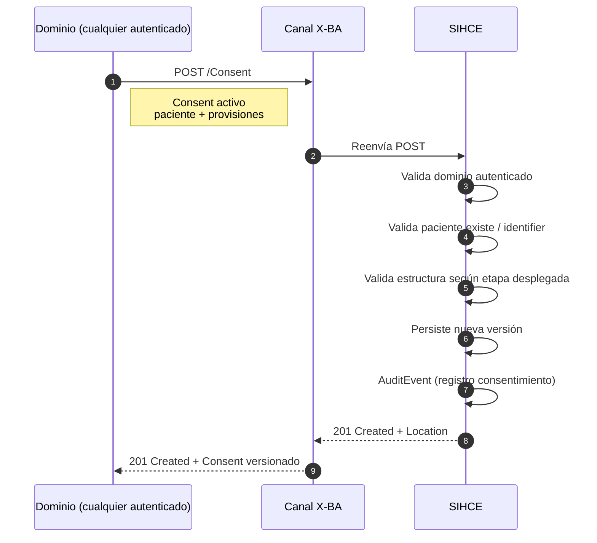
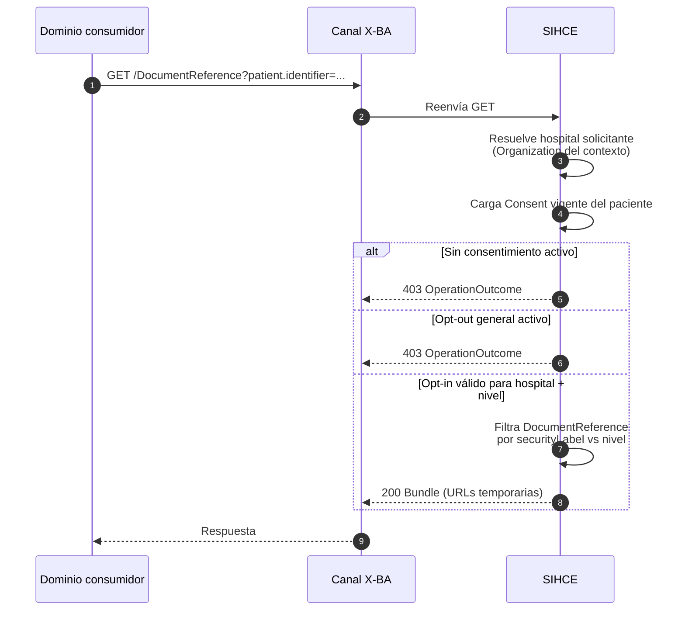

# Consentimiento de paciente en SIHCE

**Estado:** integrado en la IG v1.4.0 — ver [Operaciones](../input/pagecontent/Operaciones.md#op-consentimiento) y [ConsentSIHCE](../docs/StructureDefinition-ConsentSIHCE.html). Este archivo conserva el detalle de diseño.  
**Alcance:** registro, consulta y revocación de preferencias de privacidad del paciente en el bus SIHCE; **enforcement** en SIHCE al acceder al índice documental ([flujo de documentos](flujo_documentos.md)).  
**Recurso FHIR:** [`Consent`](https://hl7.org/fhir/R5/consent.html) (R5), perfil SIHCE a definir.

---

## 1. Resumen de decisiones de negocio

| Tema | Decisión |
|------|----------|
| Modelo | **Un `Consent` por paciente**, con `provision` anidadas cuando corresponda |
| Etapas 1 / 2 / 3 | Opciones de madurez para stakeholders; se puede **desplegar de lo simple a lo complejo** |
| Default sin consentimiento | **Denegar** todo acceso hasta que exista consentimiento activo |
| Opt-out general | **Anula todo** el acceso vigente |
| Opt-in posterior a opt-out | **Habilita solo** lo declarado en el nuevo consentimiento (no restaura grants anteriores) |
| Quién registra | **Cualquier dominio autenticado** (Canal X-BA); no exige profesional clínico (puede ser administrativo) |
| Sujeto | **Paciente** (`http://sihce.gob.ar/persona`); representantes legales **fuera de alcance inicial** |
| Institución (etapa 2/3) | **Hospital dentro de un dominio**, identificado por URL (NamingSystem por definir) |
| Niveles de privacidad | **`normal`** y **`confidential`**; **`normal` debe enviarse explícitamente** |
| Operaciones | **`POST`**, **`GET`**, **`PUT`** (revocación / actualización) |
| Historial | **Versionado** (`meta.versionId`); vigencia **hasta revocación** |
| Enforcement | **SIHCE** valida consentimiento en lista y canje de documentos |
| Auditoría | **`AuditEvent`** en cada POST (y PUT) |
**Nota FHIR R5:** el recurso `Consent` usa `subject` (no `patient`), `date` (no `dateTime`) y `decision` (`permit`/`deny`) en lugar de `provision.type` en la raíz. Ver ejemplos en la IG.

---

## 2. Las tres etapas de madurez

Las etapas no son obligatorias en cascada para el despliegue, pero el **modelo de datos** las soporta todas.

| Etapa | Nombre | Qué registra | Cuándo usarla |
|-------|--------|--------------|---------------|
| **1** | Opt-in / opt-out **general** | Participación del paciente en la red SIHCE | MVP — mínimo viable |
| **2** | Opt-in **por hospital** | Qué **hospital** (dentro de un dominio) puede acceder | Segundo incremento |
| **3** | Hospital + **nivel de privacidad** | Si el hospital accede solo a docs `normal` o también `confidential` | Máxima granularidad |

### 2.1 Semántica de niveles (etapa 3)

| Código SIHCE | Documentos visibles para el hospital |
|--------------|--------------------------------------|
| `normal` | Solo documentos **sin** etiqueta de confidencialidad elevada (o con nivel “normal”) |
| `confidential` | Documentos `normal` **más** documentos marcados **`confidential`** en `DocumentReference.securityLabel` |

> El nivel **`normal` debe ir explícito** en el `Consent`; no se infiere por omisión.

---

## 3. Actores e identificación del hospital

```text
Dominio (URI técnica)          Hospital (Organization dentro del dominio)
─────────────────────          ─────────────────────────────────────────
http://msgc.gcba.gob.ar   →    id local p. ej. "hospital-central-88392"
http://hiba.gcba.gob.ar   →    id local p. ej. "hiba-sede-central"
```

**Convención propuesta** (NamingSystem a publicar):

| Elemento | Valor |
|----------|-------|
| `actor.reference.identifier.system` | `{dominio-uri}/Organization` |
| `actor.reference.identifier.value` | Identificador local del hospital en ese dominio |

Ejemplo: dominio MSGC, hospital Central →  
`system`: `http://msgc.gcba.gob.ar/Organization`, `value`: `hospital-central-88392`

El **dominio que hace el POST** queda registrado en `sourceReference` / `performer` / auditoría; la **autorización** en etapas 2/3 es sobre el **hospital solicitante** (Organization), no sobre el dominio completo.

---

## 4. Diagrama — registro de consentimiento



---

## 5. Diagrama — enforcement en acceso a documentos

SIHCE evalúa consentimiento **antes** de devolver lista o canjear URL (ver [flujo_documentos.md](flujo_documentos.md)).



La misma evaluación se repite en **`DocumentReference/$get_binary_id`**: si el documento concreto excede el nivel autorizado, SIHCE responde **403**.

---

## 6. Reglas de evaluación (SIHCE)

Orden lógico al autorizar acceso del **hospital H** sobre el **paciente P**:

1. **¿Existe `Consent` con `status=active` para P?**  
   - **No** → **denegar** (default opt-out).
2. **¿`provision` raíz es `deny` (opt-out general)?**  
   - **Sí** → **denegar** todo (salvo que exista una versión **posterior** con opt-in que reemplace la vigente).
3. **¿Despliegue solo etapa 1?**  
   - **`provision.type=permit`** en raíz → **permitir** (sin filtro por hospital).
4. **¿Etapa 2 o 3 activa?**  
   - Buscar `provision` hija con `actor` = hospital **H** y `type=permit`.  
   - Si no hay match → **denegar**.
5. **¿Etapa 3?**  
   - Comparar `securityLabel` del `DocumentReference` con el código en la provision (`normal` | `confidential`).  
   - Documento `confidential` requiere grant `confidential`; documento normal requiere al menos `normal`.

### 6.1 Opt-out y re-opt-in

| Secuencia | Efecto |
|-----------|--------|
| v1: opt-in general + hospital A | Acceso según v1 |
| v2: opt-out general (`provision.type=deny`) | **Todo anulado** |
| v3: opt-in general + hospital B | Solo lo de v3 (hospital A **no** se restaura solo) |

Cada **PUT** / **POST** que crea versión nueva es la **fuente de verdad**; SIHCE usa siempre la **última versión activa**.

---

## 7. Operaciones REST

### 7.1 Resumen

| Operación | Método | Ruta | Descripción |
|-----------|--------|------|-------------|
| Alta / nueva versión | POST | `/Consent` | Crea consentimiento (v1) o nueva versión según política del servidor |
| Consulta | GET | `/Consent?patient.identifier={system\|value}&status=active` | Devuelve consentimiento(s) del paciente |
| Consulta por id | GET | `/Consent/{id}` | Versión actual o historial según `_history` |
| Actualización / revocación | PUT | `/Consent/{id}` | Nueva versión (p. ej. opt-out, ampliar hospitales, cambiar nivel) |

Todas las llamadas transitan el **Canal X-BA**. Autenticación: **dominio autenticado** (sin claim de profesional obligatorio).

---

## 8. Ejemplos por etapa

Terminología estándar FHIR en scope/category:

- **scope:** `http://terminology.hl7.org/CodeSystem/consentscope` → `patient-privacy`
- **category:** `http://terminology.hl7.org/CodeSystem/consent-category` → `healthcare` (o `n` / `idata` según política local documentada)

CodeSystem SIHCE propuesto para nivel:

- **system:** `http://sihce.gob.ar/CodeSystem/privacy-level`
- **codes:** `normal`, `confidential`

---

### 8.1 Etapa 1 — Opt-in general

```http
POST /Consent
Content-Type: application/fhir+json
Accept: application/fhir+json
```

```json
{
  "resourceType": "Consent",
  "meta": {
    "profile": ["http://sihce.gob.ar/StructureDefinition/ConsentSIHCE"]
  },
  "status": "active",
  "scope": {
    "coding": [{
      "system": "http://terminology.hl7.org/CodeSystem/consentscope",
      "code": "patient-privacy"
    }]
  },
  "category": [{
    "coding": [{
      "system": "http://terminology.hl7.org/CodeSystem/consent-category",
      "code": "healthcare"
    }]
  }],
  "patient": {
    "identifier": {
      "system": "http://sihce.gob.ar/persona",
      "value": "987654321"
    }
  },
  "dateTime": "2026-08-26T14:00:00-03:00",
  "provision": {
    "type": "permit"
  }
}
```

**Opt-out general** (revoca todo en la versión siguiente):

```json
{
  "resourceType": "Consent",
  "id": "consent-987654321",
  "status": "active",
  "patient": {
    "identifier": {
      "system": "http://sihce.gob.ar/persona",
      "value": "987654321"
    }
  },
  "dateTime": "2026-08-27T09:00:00-03:00",
  "provision": {
    "type": "deny"
  }
}
```

---

### 8.2 Etapa 2 — Opt-in por hospital

Opt-in general **más** autorización explícita al Hospital Central (dominio MSGC):

```json
{
  "resourceType": "Consent",
  "status": "active",
  "scope": {
    "coding": [{ "system": "http://terminology.hl7.org/CodeSystem/consentscope", "code": "patient-privacy" }]
  },
  "category": [{
    "coding": [{ "system": "http://terminology.hl7.org/CodeSystem/consent-category", "code": "healthcare" }]
  }],
  "patient": {
    "identifier": { "system": "http://sihce.gob.ar/persona", "value": "987654321" }
  },
  "dateTime": "2026-08-26T15:00:00-03:00",
  "provision": {
    "type": "permit",
    "provision": [{
      "type": "permit",
      "actor": [{
        "role": {
          "coding": [{ "system": "http://terminology.hl7.org/CodeSystem/v3-RoleClass", "code": "PROV" }]
        },
        "reference": {
          "type": "Organization",
          "identifier": {
            "system": "http://msgc.gcba.gob.ar/Organization",
            "value": "hospital-central-88392"
          },
          "display": "Hospital Central"
        }
      }]
    }]
  }
}
```

---

### 8.3 Etapa 3 — Hospital + nivel de privacidad

Mismo hospital; nivel **`normal`** explícito (solo documentos no confidential):

```json
{
  "resourceType": "Consent",
  "status": "active",
  "patient": {
    "identifier": { "system": "http://sihce.gob.ar/persona", "value": "987654321" }
  },
  "dateTime": "2026-08-26T16:00:00-03:00",
  "provision": {
    "type": "permit",
    "provision": [{
      "type": "permit",
      "actor": [{
        "reference": {
          "type": "Organization",
          "identifier": {
            "system": "http://msgc.gcba.gob.ar/Organization",
            "value": "hospital-central-88392"
          }
        }
      }],
      "securityLabel": [{
        "system": "http://sihce.gob.ar/CodeSystem/privacy-level",
        "code": "normal"
      }]
    }]
  }
}
```

Ampliación a **`confidential`** (PUT nueva versión o POST según API acordada):

```json
{
  "resourceType": "Consent",
  "id": "consent-987654321",
  "status": "active",
  "patient": {
    "identifier": { "system": "http://sihce.gob.ar/persona", "value": "987654321" }
  },
  "dateTime": "2026-08-28T11:00:00-03:00",
  "provision": {
    "type": "permit",
    "provision": [{
      "type": "permit",
      "actor": [{
        "reference": {
          "type": "Organization",
          "identifier": {
            "system": "http://msgc.gcba.gob.ar/Organization",
            "value": "hospital-central-88392"
          }
        }
      }],
      "securityLabel": [{
        "system": "http://sihce.gob.ar/CodeSystem/privacy-level",
        "code": "confidential"
      }]
    }]
  }
}
```

---

## 9. Consulta (`GET`)

```http
GET /Consent?patient.identifier=http://sihce.gob.ar/persona|987654321&status=active
Accept: application/fhir+json
```

Respuesta: `200 OK` con `Bundle` tipo `searchset`. Para historial de versiones:

```http
GET /Consent/consent-987654321/_history
```

---

## 10. Respuestas y errores

| Situación | HTTP | Notas |
|-----------|------|-------|
| Alta exitosa | 201 | Cabecera `Location: /Consent/{id}`; cuerpo con `meta.versionId` |
| Consulta exitosa | 200 | Bundle o recurso |
| Paciente inexistente | 404 / 422 | Según validación de negocio |
| Dominio no autenticado | 401 | Canal X-BA |
| Estructura inválida (falta `normal`, hospital sin id, etc.) | 422 | `OperationOutcome` |
| Acceso documental sin consentimiento | 403 | En GET `DocumentReference` / `$get_binary_id` |

Ejemplo — acceso denegado por falta de consentimiento:

```json
{
  "resourceType": "OperationOutcome",
  "issue": [{
    "severity": "error",
    "code": "forbidden",
    "diagnostics": "No existe consentimiento activo del paciente para acceder al índice documental."
  }]
}
```

---

## 11. Auditoría

En cada **POST** y **PUT** exitoso (o fallido, según política), SIHCE genera **`AuditEvent`** con:

- Paciente (`entity` → Patient identifier)
- Dominio solicitante (actor)
- Acción (`C` create / `U` update)
- Resultado (éxito / denegación)
- Referencia al `Consent` / versión

---

## 12. Integración con flujo de documentos

Este consentimiento es **prerrequisito** del [flujo de acceso a documentos](flujo_documentos.md) (vía principal de diseño):

| Fase documentos | Control de consentimiento |
|-----------------|---------------------------|
| A — `GET DocumentReference` | SIHCE filtra o deniega según etapa desplegada |
| B — `$get_binary_id` | SIHCE revalida nivel vs `securityLabel` del documento |
| C — GET al emisor | Token de documento solo emitido si A/B pasaron consentimiento |

---

## 13. Roadmap de despliegue sugerido

| Fase | Capacidad | Etapa |
|------|-----------|-------|
| MVP | POST/GET Consent + enforcement opt-in/out general | 1 |
| v2 | Actor Organization (hospital) + filtro por hospital | 2 |
| v3 | `securityLabel` + filtro confidential | 3 |

---

## 14. Pendientes de implementación en IG

1. Perfil **`ConsentSIHCE`** (FSH): cardinalidades, slices de `provision`, actor Organization obligatorio en etapa 2+.
2. **NamingSystem** `{dominio-uri}/Organization` (plantilla + ejemplos MSGC/HIBA).
3. **CodeSystem** `http://sihce.gob.ar/CodeSystem/privacy-level` (`normal`, `confidential`).
4. **ConceptMap** modelo lógico → Consent (si se define modelo lógico `Consentimiento`).
5. Ejemplos en `Operaciones.md` y diagrama en `CasosDeUso.md`.
6. Representantes legales / menores (futuro).

---

## 15. Referencias

- [Flujo de acceso a documentos](flujo_documentos.md)
- [FHIR R5 Consent](https://hl7.org/fhir/R5/consent.html)
- [FHIR Consent Scope](http://terminology.hl7.org/CodeSystem/consentscope)
- [FHIR Consent Category](http://terminology.hl7.org/CodeSystem/consent-category)
- IG publicada: `input/pagecontent/Operaciones.md` (operaciones persona/documento actuales)
