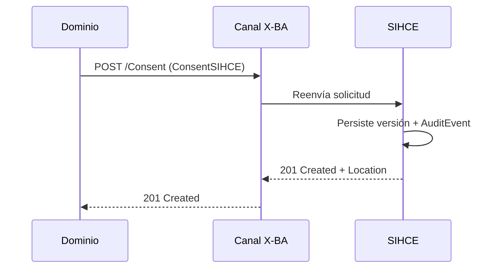

Preferencias de privacidad del paciente en la red SIHCE. **Default:** sin consentimiento activo, el acceso al índice documental se **deniega**. Cualquier dominio autenticado puede registrar el consentimiento (incluido personal administrativo).

Operaciones: [Registro, consulta y PUT](Operaciones-Consentimiento.html#op-consentimiento). Perfil: [ConsentSIHCE](StructureDefinition-ConsentSIHCE.html).

Volver al [índice de casos de uso](CasosDeUso.html).

### Registro de consentimiento

Etapas de madurez (despliegue incremental):

| Etapa | Qué registra |
|-------|----------------|
| 1 | Opt-in / opt-out **general** |
| 2 | Opt-in por **hospital** (Organization en el dominio) |
| 3 | Hospital + nivel **`normal`** o **`confidential`** (explícito) |

Opt-out general anula todo; un opt-in posterior solo habilita lo declarado en la nueva versión.
