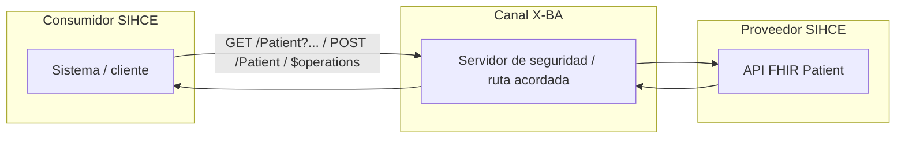
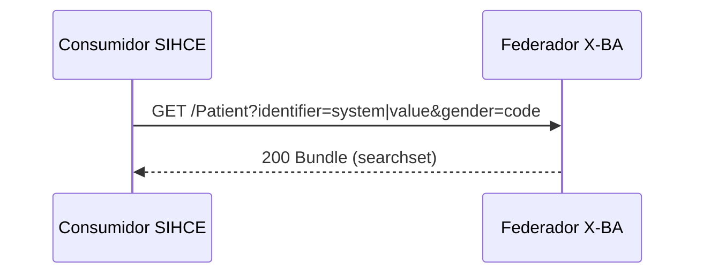
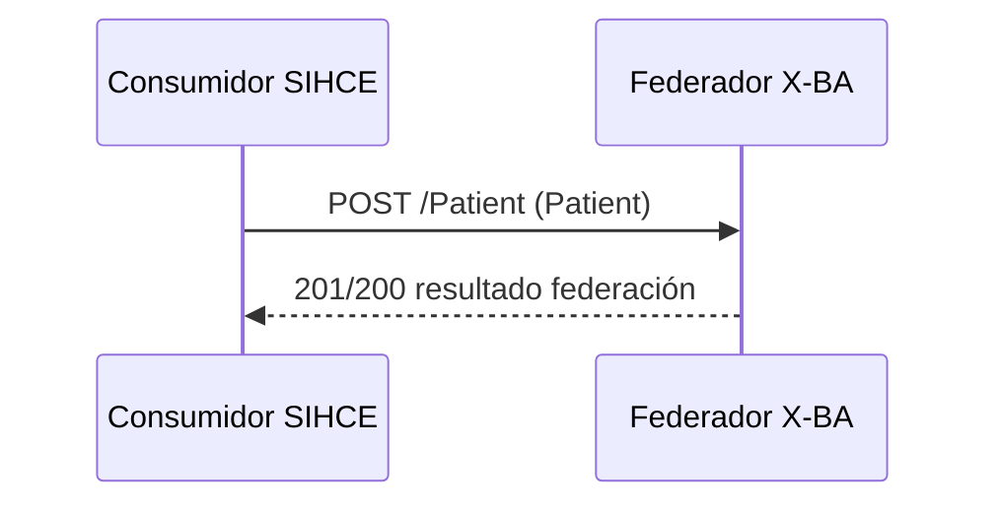
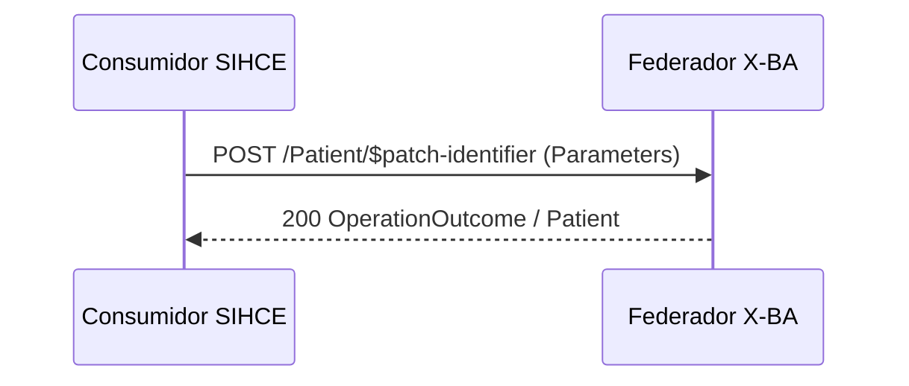
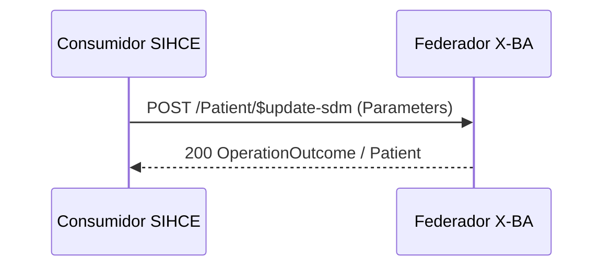

Estos son los principales casos de uso e interacciones entre consumidor SIHCE y proveedor X-BA.

## Vista general (intercambio)

## Persona

### Búsqueda de persona

Operación relacionada: [Búsqueda por identificador y género](Operaciones.html#op-busqueda).

### Alta/Federación de persona

Operación relacionada: [Alta/Federación de paciente](Operaciones.html#op-alta-federacion). Cuerpo conforme al perfil [PatientXBA](StructureDefinition-PatientXBA.html).

### Modificación de identificador local

Operación relacionada: [Patch de identificador local](Operaciones.html#op-patch-identifier).

### Modificación de SDM

Operación relacionada: [Update de SDM](Operaciones.html#op-update-sdm).

