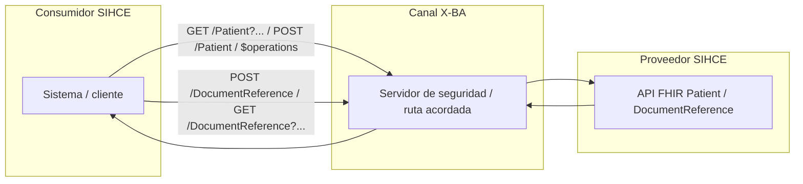
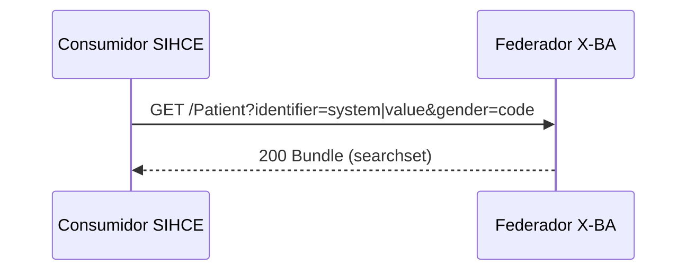
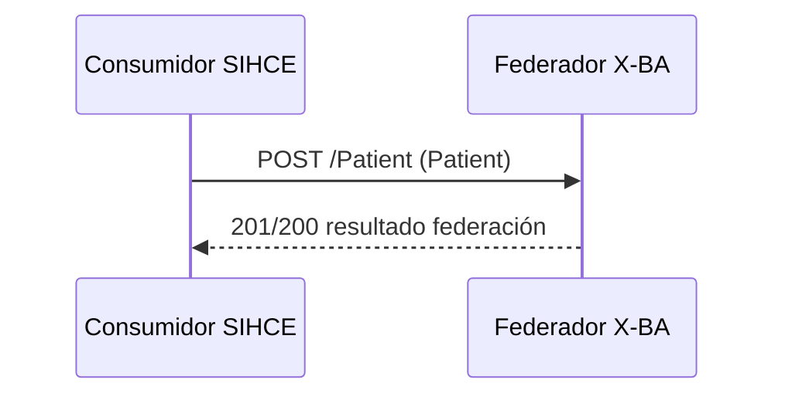
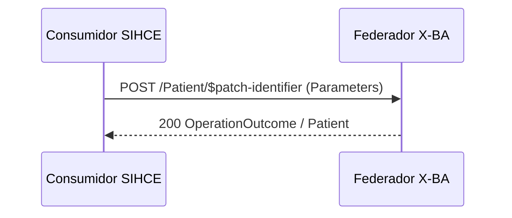
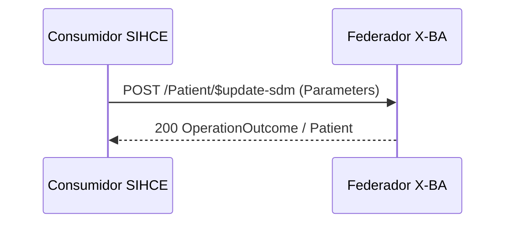
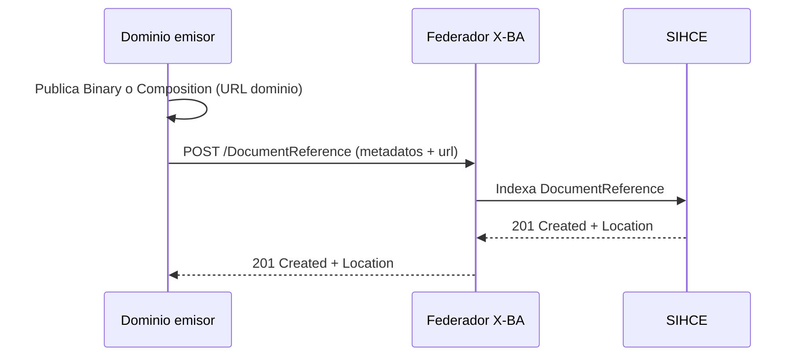
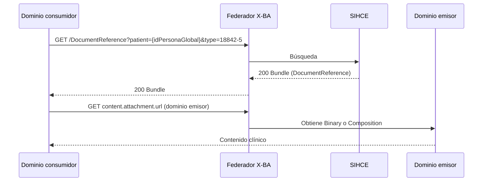

Estos son los principales casos de uso e interacciones entre consumidor SIHCE y proveedor X-BA.

## Vista general (intercambio)



## Persona

### Búsqueda de persona

Operación relacionada: [Búsqueda por identificador y género](Operaciones.html#op-busqueda).



### Alta/Federación de persona

Operación relacionada: [Alta/Federación de paciente](Operaciones.html#op-alta-federacion). Cuerpo conforme al perfil [PatientXBA](StructureDefinition-PatientXBA.html).



### Modificación de identificador local

Operación relacionada: [Patch de identificador local](Operaciones.html#op-patch-identifier).



### Modificación de SDM

Operación relacionada: [Update de SDM](Operaciones.html#op-update-sdm).



## Documentos clínicos

### Registro de epicrisis (dominio → SIHCE)

Operación relacionada: [Registro de documento clínico](Operaciones.html#op-documento-registro). Cuerpo conforme al perfil [DocumentReferenceSIHCE](StructureDefinition-DocumentReferenceSIHCE.html); tipo LOINC `18842-5`.



### Consulta de epicrisis por paciente

Operación relacionada: [Consulta de documentos clínicos](Operaciones.html#op-documento-consulta).



Niveles de madurez epicrisis:

| Nivel | Contenido en URL del dominio |
|-------|------------------------------|
| 1 | Binary (`application/pdf` o `application/xml`) |
| 2 | [CompositionEpicrisisSIHCE](StructureDefinition-CompositionEpicrisisSIHCE.html) con secciones narrativas |
| 3 | Composition con secciones codificadas (`Condition`, `MedicationStatement`) |

### Registro de informe de laboratorio (dominio → SIHCE)

Operación relacionada: [Registro de documento clínico](Operaciones.html#op-documento-registro). Tipo LOINC `11502-2`; URL a [DiagnosticReportLaboratorioSIHCE](StructureDefinition-DiagnosticReportLaboratorioSIHCE.html) en el dominio.

```mermaid
sequenceDiagram
  participant D as Dominio laboratorio
  participant X as Federador X-BA
  participant S as SIHCE
  D->>D: Publica DiagnosticReport (presentedForm PDF; result opcional)
  D->>X: POST /DocumentReference (metadatos + url DiagnosticReport)
  X->>S: Indexa DocumentReference
  S-->>X: 201 Created + Location
  X-->>D: 201 Created + Location
```

Niveles de madurez informe de laboratorio:

| Nivel | Contenido DiagnosticReport en dominio |
|-------|----------------------------------------|
| 1 | Solo `presentedForm` (PDF) |
| 2 | `presentedForm` + `result` con [ObservationLaboratorioSIHCE](StructureDefinition-ObservationLaboratorioSIHCE.html) |

### Consulta de informes de laboratorio por paciente

Operación relacionada: [Consulta de documentos clínicos](Operaciones.html#op-documento-consulta).

```mermaid
sequenceDiagram
  participant C as Dominio consumidor
  participant X as Federador X-BA
  participant S as SIHCE
  participant L as Dominio laboratorio
  C->>X: GET /DocumentReference?patient={idPersonaGlobal}&type=11502-2
  X->>S: Búsqueda
  S-->>X: 200 Bundle (DocumentReference)
  X-->>C: 200 Bundle
  C->>X: GET content.attachment.url
  X->>L: Obtiene DiagnosticReport
  L-->>C: PDF en presentedForm; Observation en result (nivel 2)
```

