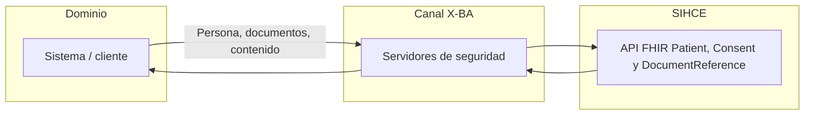
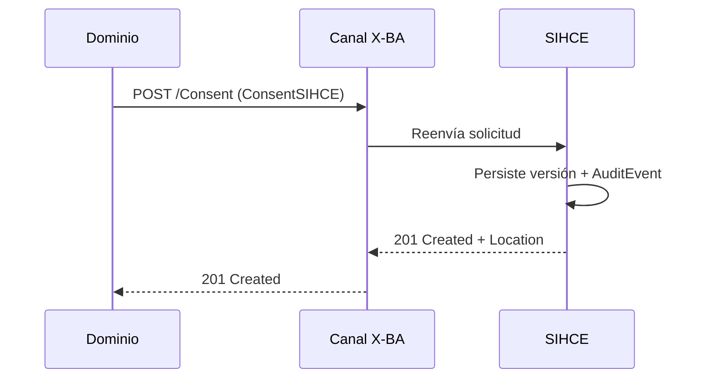
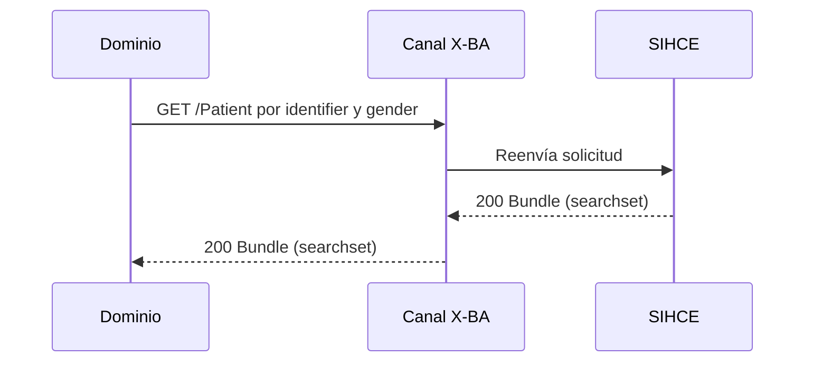
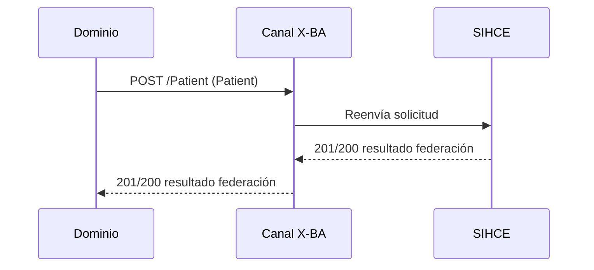
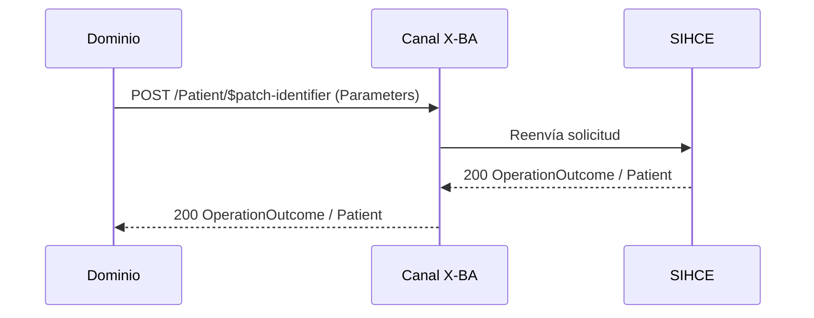
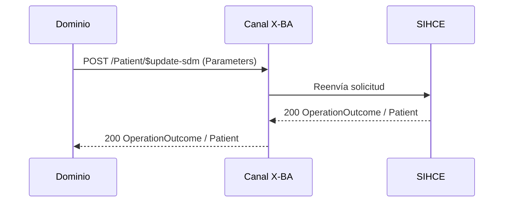
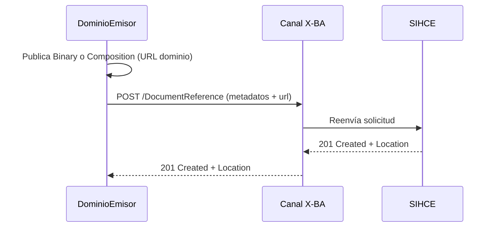
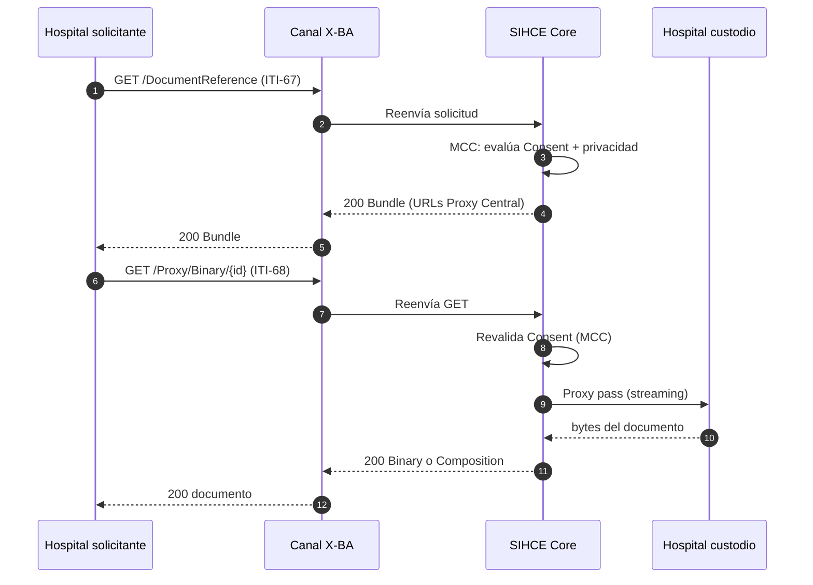
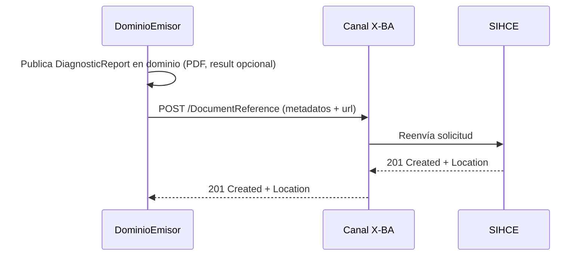
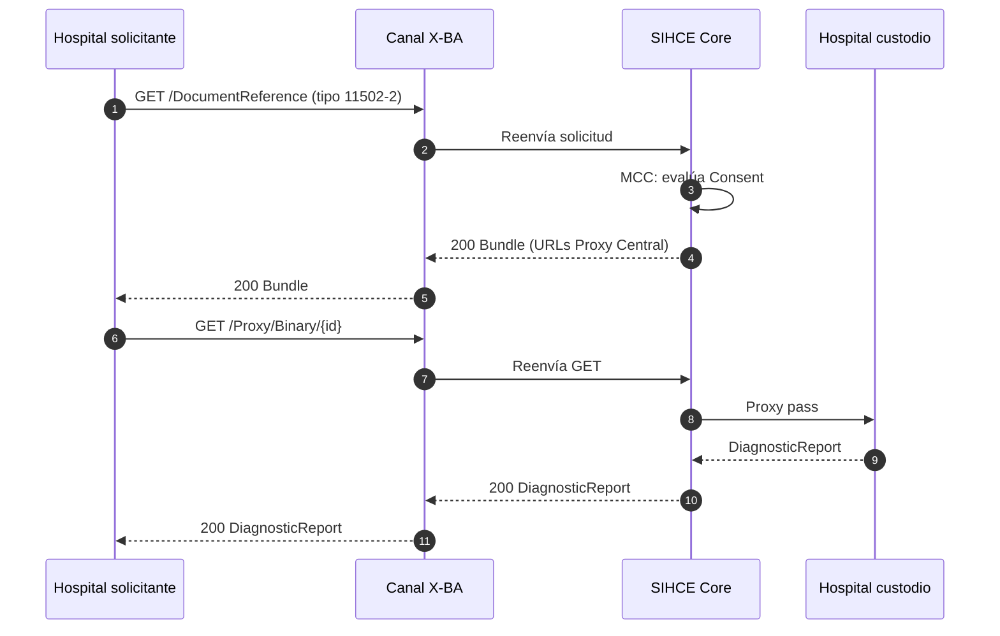

Estos son los principales casos de uso e interacciones entre dominios y **SIHCE**.

**Canal X-BA** es la capa de seguridad (servidores de seguridad / ruta acordada): **todo** intercambio FHIR entre organizaciones transita por ese canal. No es un actor de negocio.

**SIHCE** expone capacidades de negocio (federación de personas, **consentimiento**, registro y consulta del índice documental). El “federador” no es un sistema aparte: es la funcionalidad de SIHCE sobre `Patient`.

## Vista general (intercambio)

Todo mensaje entre dominio y SIHCE viaja por el **Canal X-BA**. SIHCE responde según la operación: federación de persona, **consentimiento (MCC)**, registro documental, búsqueda ITI-67 o descarga ITI-68 vía **Proxy Central**.

## Consentimiento

Preferencias de privacidad del paciente en la red SIHCE. **Default:** sin consentimiento activo, el acceso al índice documental se **deniega**. Cualquier dominio autenticado puede registrar el consentimiento (incluido personal administrativo).

Operaciones: [Registro, consulta y PUT](Operaciones.html#op-consentimiento). Perfil: [ConsentSIHCE](StructureDefinition-ConsentSIHCE.html).

### Registro de consentimiento

Etapas de madurez (despliegue incremental):

| Etapa | Qué registra |
|-------|----------------|
| 1 | Opt-in / opt-out **general** |
| 2 | Opt-in por **hospital** (Organization en el dominio) |
| 3 | Hospital + nivel **`normal`** o **`confidential`** (explícito) |

Opt-out general anula todo; un opt-in posterior solo habilita lo declarado en la nueva versión.

## Persona

### Búsqueda de persona

Operación relacionada: [Búsqueda por identificador y género](Operaciones.html#op-busqueda).

### Alta/Federación de persona

Operación relacionada: [Alta/Federación de paciente](Operaciones.html#op-alta-federacion). Cuerpo conforme al perfil [PatientXBA](StructureDefinition-PatientXBA.html).

### Modificación de identificador local

Operación relacionada: [Patch de identificador local](Operaciones.html#op-patch-identifier).

### Modificación de SDM

Operación relacionada: [Update de SDM](Operaciones.html#op-update-sdm).

## Documentos clínicos

Todo documento clínico se indexa en SIHCE como `DocumentReference` ([DocumentReferenceSIHCE](StructureDefinition-DocumentReferenceSIHCE.html)). **Epicrisis** e **informe de laboratorio** son casos especiales del mismo patrón (distintos LOINC y distinto recurso detrás de `content.attachment.url`).

### Registro de epicrisis (dominio → SIHCE)

Operación relacionada: [Registro de documento clínico](Operaciones.html#op-documento-registro). Cuerpo conforme al perfil [DocumentReferenceSIHCE](StructureDefinition-DocumentReferenceSIHCE.html); tipo LOINC `18842-5`. Capacidad SIHCE: **registro documental**.

### Consulta de epicrisis por paciente

Operaciones: [Búsqueda ITI-67](Operaciones.html#op-documento-consulta), [Descarga ITI-68 vía Proxy](Operaciones.html#op-documento-proxy). SIHCE evalúa **Consent (MCC)** en la búsqueda; la URL del índice apunta al Proxy Central; la descarga es un GET estándar con proxy pass al hospital custodio.

Niveles de madurez epicrisis:

| Nivel | Contenido en URL del dominio |
|-------|------------------------------|
| 1 | Binary (`application/pdf` o `application/xml`) |
| 2 | [CompositionEpicrisisSIHCE](StructureDefinition-CompositionEpicrisisSIHCE.html) con secciones narrativas |
| 3 | Composition con secciones codificadas (`Condition`, `MedicationStatement`) |

### Registro de informe de laboratorio (dominio → SIHCE)

Operación relacionada: [Registro de documento clínico](Operaciones.html#op-documento-registro). Tipo LOINC `11502-2`; URL a [DiagnosticReportLaboratorioSIHCE](StructureDefinition-DiagnosticReportLaboratorioSIHCE.html) en el dominio. Capacidad SIHCE: **registro documental**.

Niveles de madurez informe de laboratorio:

| Nivel | Contenido DiagnosticReport en dominio |
|-------|----------------------------------------|
| 1 | Solo `presentedForm` (PDF) |
| 2 | `presentedForm` + `result` con [ObservationLaboratorioSIHCE](StructureDefinition-ObservationLaboratorioSIHCE.html) |

### Consulta de informes de laboratorio por paciente

Operaciones: [Búsqueda ITI-67](Operaciones.html#op-documento-consulta), [Descarga ITI-68 vía Proxy](Operaciones.html#op-documento-proxy). Mismo patrón que epicrisis: Consent en MCC, URL del Proxy Central, proxy pass al DiagnosticReport en el custodio.

