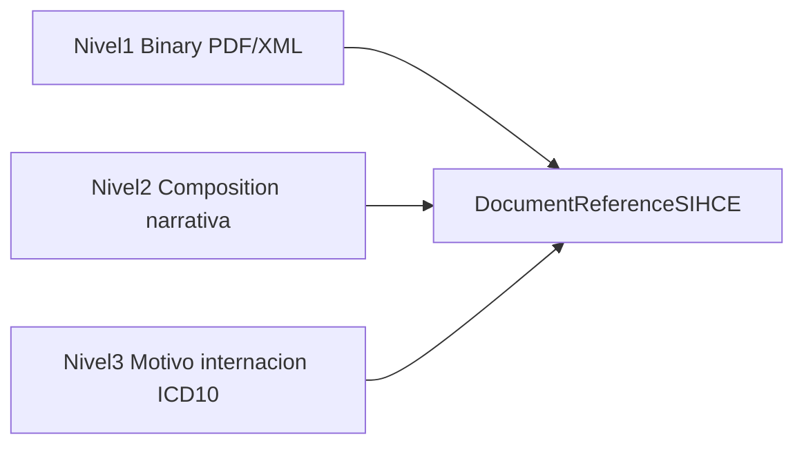

Fuente de verdad del consenso de **epicrisis** (discharge summary, LOINC `18842-5`) en la red SIHCE: tres niveles de madurez de contenido y el inventario de secciones acordado.

Flujos de registro/consulta: [Casos de Uso — Documentos](CasosDeUso-Documentos.html). Índice documental: [DocumentReferenceSIHCE](StructureDefinition-DocumentReferenceSIHCE.html). Propuestas de secciones a codificar (votación): [Epicrisis — secciones propuestas](Epicrisis-Secciones-Propuestas.html).

### Tres niveles de madurez de contenido

| Nivel | Qué entrega el dominio en `content.attachment.url` | Perfil / recurso |
|-------|-----------------------------------------------------|------------------|
| **1 — Archivo adjunto** | Binary PDF o XML | [DocumentReferenceSIHCE](StructureDefinition-DocumentReferenceSIHCE.html) + Binary |
| **2 — Composition con secciones estandarizadas** | Composition narrativa (texto por sección) | [CompositionEpicrisisSIHCE](StructureDefinition-CompositionEpicrisisSIHCE.html) |
| **3 — Secciones codificadas cuando corresponda** | Composition + entradas FHIR en secciones habilitadas | Hoy: **Motivo de internación** → [ConditionEpicrisisSIHCE](StructureDefinition-ConditionEpicrisisSIHCE.html) + ICD-10 |

La guía en conjunto permanece `draft`; los artefactos de epicrisis tipados están en **trial-use / FMM 3** ([Aspectos Generales](Aspectos-Generales.html#niveles-de-madurez-fmm)).

#### Nivel 1 — Archivo adjunto

El dominio publica el documento clínico como Binary (`application/pdf` o `application/xml`) y registra solo metadatos en SIHCE. Ejemplo: [DocumentReferenceEpicrisisNivel1](DocumentReference-DocumentReferenceEpicrisisNivel1.html).

#### Nivel 2 — Secciones estandarizadas (narrativa)

La URL apunta a una [CompositionEpicrisisSIHCE](StructureDefinition-CompositionEpicrisisSIHCE.html) con `section.text` en las slices tipadas. No se exige `section.entry` salvo Motivo de internación en nivel 3. Ejemplo: [CompositionEpicrisisNivel2](Composition-CompositionEpicrisisNivel2.html).

La tabla de consenso (abajo) indica qué secciones del negocio ya tienen slice en el perfil y cuáles siguen propuestas.

#### Nivel 3 — Codificación (hoy solo Motivo de internación)

Única sección normativa codificada en esta versión:

- Slice `motivoInternacion` (LOINC **46241-6** *Reason for hospitalization*)
- `section.entry` → [ConditionEpicrisisSIHCE](StructureDefinition-ConditionEpicrisisSIHCE.html)
- `Condition.code` → [SIHCEMotivoInternacionICD10VS](ValueSet-sihce-motivo-internacion-icd10-vs.html) (ICD-10, extensible)

El resto de secciones candidatas a codificar están en [Epicrisis — secciones propuestas](Epicrisis-Secciones-Propuestas.html) (mapeo sección → recurso / elementos, alineado a IPS 2.0); **no** son exigidas por el Composition.

Ejemplo: [CompositionEpicrisisNivel3](Composition-CompositionEpicrisisNivel3.html).

### Consenso de secciones

| Categoría | Datos |
|-----------|--------|
| **Obligatorio (17)** | Identificación del paciente; Fechas y horas; Tipo de ingreso y procedencia; Motivo de internación; Problemas y antecedentes; Alergias; Medicación de ingreso; Directivas anticipadas; Evolución; Procedimientos; Diagnóstico de alta; Estado clínico al alta; Estudios pendientes; Medicación de alta; Plan de tratamiento; Tipo y destino de egreso; Autor, validación y firma |
| **Recomendado (7)** | Cobertura; Dispositivos e implantes; Reconciliación de fármacos; Pautas de alarma; Citas y controles; Metadatos del documento; Adjuntos y referencias |
| **Opcional (11)** | Profesional responsable; Médico de cabecera; Diagnóstico de admisión; Alertas y precauciones; Historia social; Vacunas; Examen físico de ingreso; Signos vitales; Tratamientos en internación; Resumen de estudios; Preocupaciones del paciente |
| **A definir (3)** | Servicio y cama; Embarazo y obstétricos; Estado funcional |

#### Estado en el perfil Composition (nivel 2+)

| Sección (consenso) | Categoría | LOINC / path | Estado en perfil |
|--------------------|-----------|--------------|------------------|
| Identificación del paciente | Obligatorio | `Composition.subject` | slice / tipado (cabecera) |
| Fechas y horas | Obligatorio | `Composition.date` | slice / tipado (cabecera) |
| Autor, validación y firma | Obligatorio | `Composition.author` | slice / tipado (cabecera) |
| Motivo de internación | Obligatorio | 46241-6 | **slice** + **nivel 3 ICD-10** |
| Alergias | Obligatorio | 48765-2 | slice (narrativa) |
| Diagnóstico de alta | Obligatorio | 78375-3 | slice (narrativa) |
| Medicación de alta | Obligatorio | 75311-1 | slice (narrativa) |
| Evolución | Obligatorio | 8648-8 | slice (narrativa) |
| Plan de tratamiento | Obligatorio | 18776-5 | slice (narrativa) |
| Medicación de ingreso | Obligatorio | 42346-7 | slice (narrativa) |
| Procedimientos | Obligatorio | 47519-4 | slice (narrativa) |
| Problemas y antecedentes | Obligatorio | 11450-4 | slice (narrativa) |
| Diagnóstico de admisión | Opcional | 42347-5 | slice (narrativa) |
| Resumen de estudios | Opcional | 11493-4 | slice (narrativa) |
| Examen físico de ingreso | Opcional | 10184-0 | slice (narrativa) |
| Instrucciones / estado al alta (parcial) | Obligatorio | 8653-8 | slice (narrativa; cobertura parcial del consenso) |
| Tipo de ingreso y procedencia | Obligatorio | — | propuesto |
| Directivas anticipadas | Obligatorio | — | a votar |
| Estado clínico al alta | Obligatorio | — | propuesto |
| Estudios pendientes | Obligatorio | — | propuesto |
| Tipo y destino de egreso | Obligatorio | — | propuesto |
| Cobertura y resto recomendado/opcional/a definir | Rec./Opc./TBD | — | a votar / propuesto |

Las filas “propuesto” / “a votar” no tienen slice MS aún; el slicing del Composition permanece **open** para permitir secciones adicionales sin romper el perfil.
