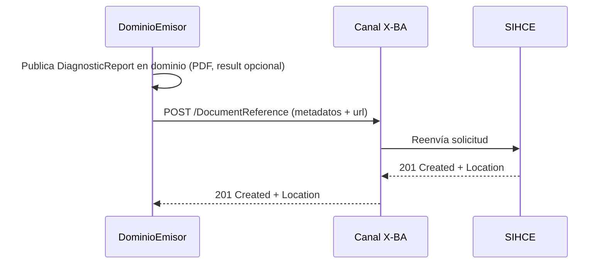
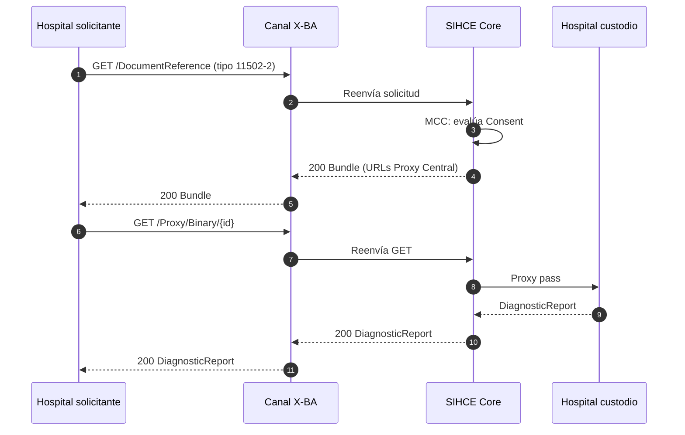

### Registro de informe de laboratorio (dominio → SIHCE)

Operación relacionada: [Registro de documento clínico](Operaciones-Documentos.html#op-documento-registro). Tipo LOINC `11502-2`; URL a [DiagnosticReportLaboratorioSIHCE](StructureDefinition-DiagnosticReportLaboratorioSIHCE.html) en el dominio. Capacidad SIHCE: **registro documental**.

Niveles de madurez informe de laboratorio:

| Nivel | Contenido DiagnosticReport en dominio |
|-------|----------------------------------------|
| 1 | Solo `presentedForm` (PDF) |
| 2 | `presentedForm` + `result` con [ObservationLaboratorioSIHCE](StructureDefinition-ObservationLaboratorioSIHCE.html) |

### Consulta de informes de laboratorio por paciente

Operaciones: [Búsqueda ITI-67](Operaciones-Documentos.html#op-documento-consulta), [Descarga ITI-68 vía Proxy](Operaciones-Documentos.html#op-documento-proxy). Mismo patrón que epicrisis: Consent en MCC, URL del Proxy Central, proxy pass al DiagnosticReport en el custodio.

